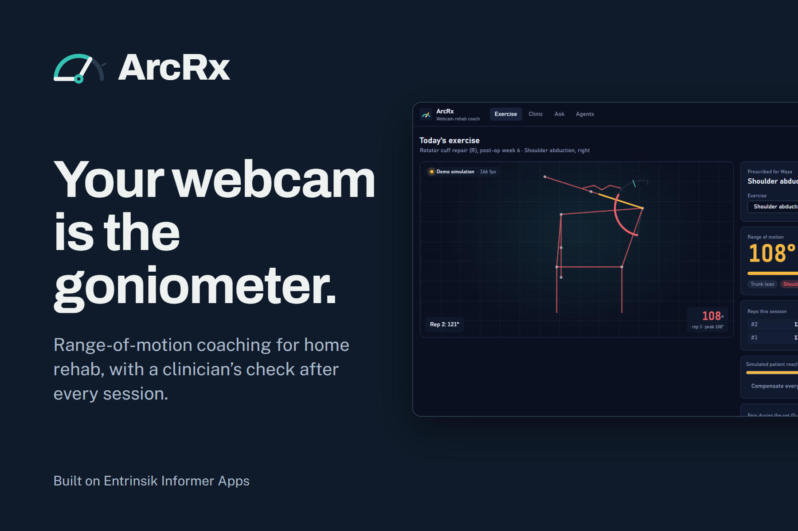
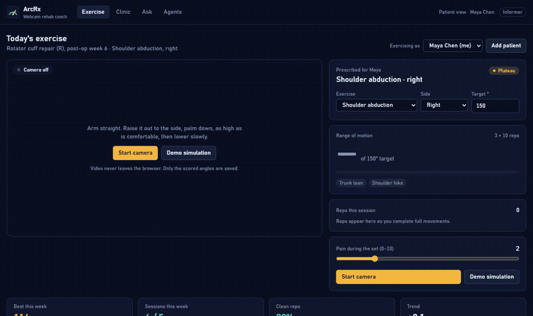
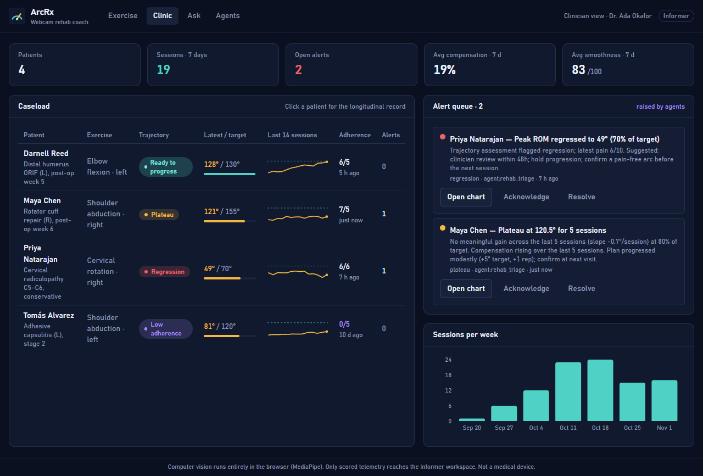
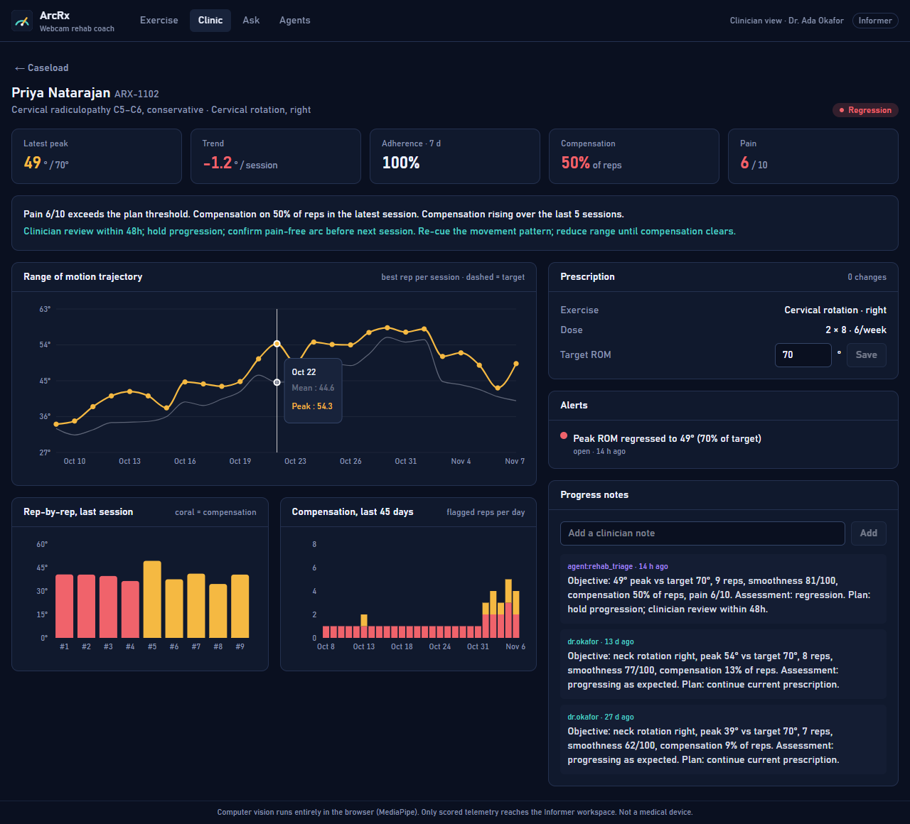
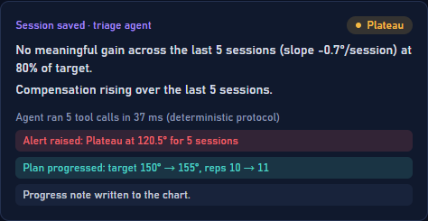
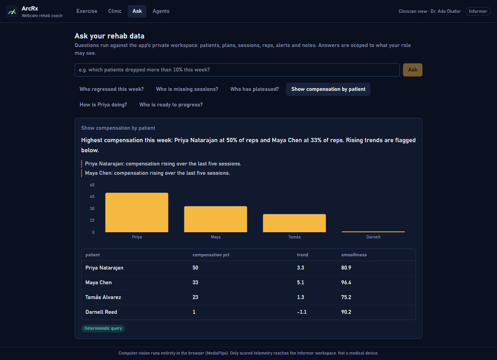
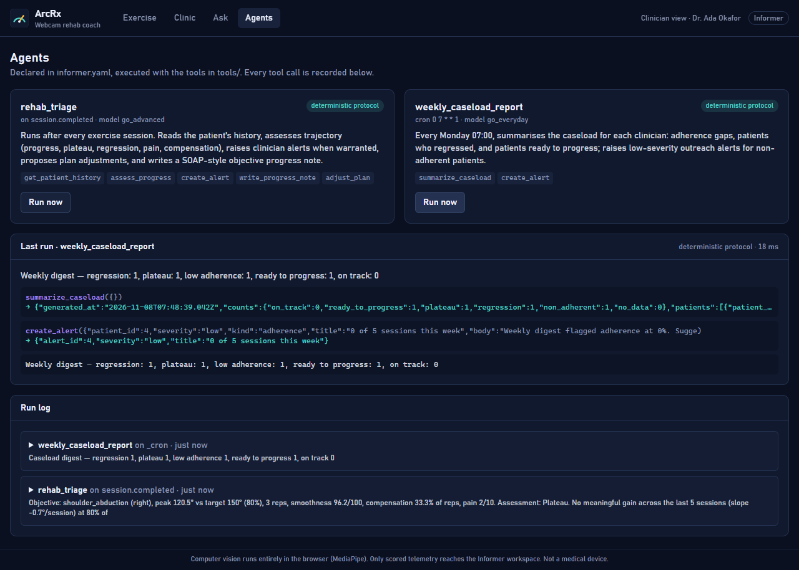
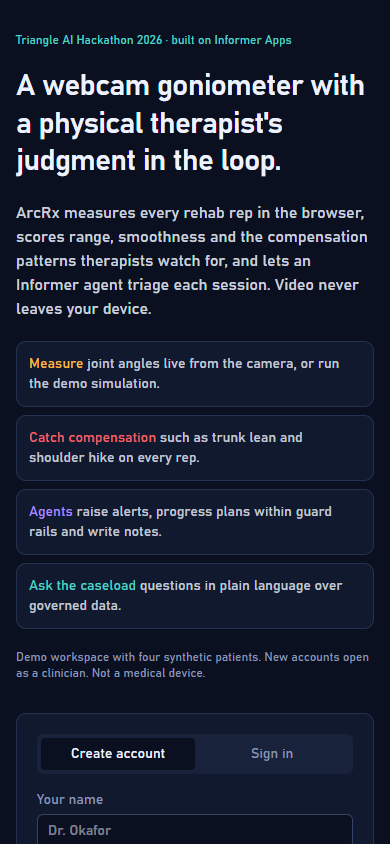
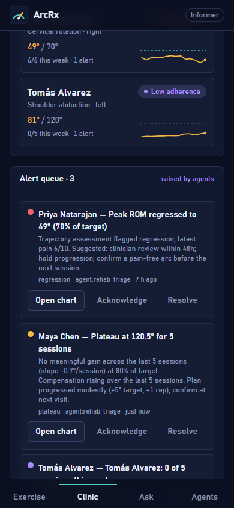
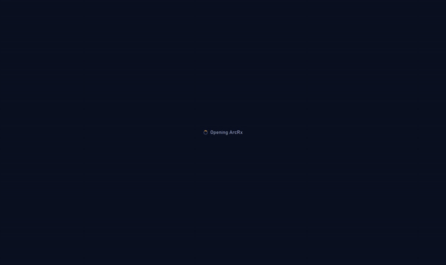

<p align="center">
  
</p>

# ArcRx: a webcam goniometer with a physical therapist's judgment in the loop

**Triangle AI Hackathon 2026 · Health & Wellness track · Entrinsik Challenge: Best Use of Informer Apps**



ArcRx turns a laptop webcam into a clinical range-of-motion instrument. A patient does their
prescribed rehab exercise in front of the browser. MediaPipe measures the joint angle every frame
on the device, scores every rep for range, smoothness and *compensation* (the cheating patterns
therapists watch for), and saves only the numbers to a governed Informer workspace. A triage
protocol then acts on the session: it raises clinician alerts, progresses the prescription within
guard rails and writes an objective progress note. Clinicians get longitudinal dashboards, an alert
queue and plain-language questions over their caseload.



<sub>Recorded with **Demo simulation**, a synthetic patient driven through the same pipeline as the camera. With the camera on, the same arc and readouts are drawn over your own video.</sub>

**Live on Informer:** https://bodapati-arcrx-rehab-coach.go.informer-apps.com. Open it on a phone
or laptop, create an account or sign in with Informer. The workspace holds four synthetic
patients. To add a patient, use the clinic code `2026`.

```bash
npm install
npm run dev            # http://localhost:5173, fully offline: embedded Postgres + the same server code
npm run demo:offline   # the production bundle on http://localhost:4173 with the same offline API
npm test               # server and computer-vision checks, no network needed
```

The two offline servers share one local workspace, so run one at a time. A second one refuses
to open it rather than risk corrupting it.

---

## Problem

After orthopaedic surgery or injury, recovery depends on home exercise programs done alone for
weeks. Published adherence is roughly 35–50%, and therapists only learn that a patient has stalled,
regressed or started compensating at the next visit. Range of motion, the primary outcome, is
measured with a hand-held goniometer a few times a month. Nobody sees the other 95% of the reps.

## Solution

- **Measure every rep, on the device.** Pose and face landmark models run in the browser
  (WebGL/WASM, served from the app itself, never from a CDN). Shoulder abduction and elbow flexion
  use the pose model; cervical rotation and lateral flexion use the face model's head transform. A
  One Euro filter and a 1.5-second calibration to the patient's own neutral posture give stable,
  repeatable angles. Frames never leave the device.
- **Score movement quality, not just count.** Each rep records peak angle, duration, end-range
  hold, a smoothness score and compensation flags: trunk lean, shoulder hike, shoulder drift,
  head tilt, chin drop. When tracking is lost the gauge says so instead of showing a stale number.
- **Govern the data in Informer.** Sessions and reps land in the app's private Postgres workspace.
  Patients see only their own record; clinicians see the caseload. Every route enforces the role
  server-side, and session saves are idempotent, so a retry after a dropped connection never
  writes a duplicate.
- **Let an agent act.** `rehab_triage` is declared on every `session.completed` event: it reads 30
  days of history, runs a trajectory assessment (on track, ready to progress, plateau, regression,
  low adherence), raises alerts, adjusts the plan inside guard rails (±10° target, ±2 reps) and
  writes a SOAP-style note. `weekly_caseload_report` runs Monday 07:00 and flags adherence gaps.
  Every tool call is written to an audit log the clinic can read.
- **Add patients safely.** A clinician adds a patient with their first prescription. The form needs
  a clinic code (`ARCRX_CLINIC_CODE` in the app's Environment, demo default `2026`), and "This is
  me" links the record to the signed-in account.
- **Ask the data.** "Who regressed this week?" is answered by a model-drafted, validated,
  read-only SQL query when the Informer tenant has a model, or by a deterministic intent router over
  the same tables. Both are scoped to the asker's role, and the answer is labelled with its source.

### How the agents run today

The live tenant has an AI credit pool but no models in its catalog yet, so Informer's own agent
runner cannot start `rehab_triage`. The app detects this (`/api/ai-budget` and `/api/chat-models`)
and runs the identical protocol in-process with the same tools, writing the same audit rows. The
app labels these runs "deterministic protocol". Once the tenant syncs a model, Informer runs the
declared agents with no code change.

## Screenshots

**Clinic dashboard.** The caseload with each patient's trajectory, adherence and last 14 sessions, and the alert queue raised by the agents.



**Patient record.** The range-of-motion trajectory against the target, rep-by-rep bars with compensation in coral, compensation over 45 days, the prescription, alerts and the agent's notes.



| Triage result after a session | Ask the caseload |
|---|---|
|  |  |

**Agents.** The two agents declared in `informer.yaml`, a manual run of the weekly digest, and the auditable tool calls.



**On a phone.** The public landing page and sign-up, and the clinic as cards with a bottom tab bar.

<p>
  
  &nbsp;
  
</p>

**A clinician's tour:** dashboard, a patient's chart, a question, and a manual agent run.



## Tech stack

| Layer | Choice | Why |
|---|---|---|
| Frontend | Vite 8, React 19, TypeScript, Tailwind v4, Recharts | Informer's documented app shape; fast local dev |
| Computer vision | `@mediapipe/tasks-vision` Pose Landmarker (lite) + Face Landmarker, GPU delegate with CPU fallback | Browser-native; runtime and models served from the app's own origin |
| Signal processing | One Euro filter, calibration window, rep state machine | Stable angles without lag; clinically meaningful rep boundaries |
| App platform | **Entrinsik Informer Apps** (`@entrinsik/vite-plugin-informer` 2.14, Informer 2026.2) | Roles, public serving with app accounts, private Postgres workspace, sandboxed server routes, events, agents, deploy pipeline |
| Offline mirror | PGlite (Postgres in WASM) + the same handler contract | `npm run dev` and `npm run demo:offline` work with no Informer instance and no network |
| Models (optional) | Informer AI (`go_everyday` / `go_advanced`) when the tenant has them; Anthropic SDK (`claude-opus-5-5`) in the offline mirror with a key | Agents and NL→SQL. Without a model, the deterministic protocol and intent router run instead |

## Informer Apps architecture

```
informer.yaml          roles, public access + app sign-up, env (clinic code), events, two agents
migrations/            001 schema · 002 six weeks of demo data · 003 agent audit log
                       004 manual-run rate limit · 005 idempotent session saves
server/                file-convention routes → /api/…
  me.js                session probe (who is signed in, with which roles)
  patients/            caseload with trajectory assessment; POST adds a patient (clinic code)
  patients/[id]        longitudinal record; DELETE (admin only, seeded patients protected)
  sessions/            POST stores a scored session (idempotent), emits session.completed
  alerts/, notes/, plans/[id], caseload/, exercises/
  agents/runs          the audit log, grouped into runs
  agents/status        whether the tenant has a model (drives the Agents tab badge)
  agents/trigger       "Run now": Informer's agent API, or the in-process protocol without a model (rate-limited)
  ask/                 questions → validated read-only SQL (with a model) or the intent router
tools/                 agent tools: get_patient_history, assess_progress, create_alert,
                       write_progress_note, adjust_plan, summarize_caseload
agents/                runbooks + deterministic fallback plans for the offline mirror
lib/                   exercise catalogue, trajectory assessment, SQL guard, audit log,
                       in-process triage protocol
src/cv/                landmarks → angles → One Euro → rep detector → overlay; simulator
dev/local-informer.ts  offline mirror of the Informer dev server (dev and preview)
```

**Handler contract.** Every route and tool receives Informer's sandbox bag: `query(sql, params)`
against the app's Postgres workspace, `transaction`, `fetch`, `emit(event, payload)`, `notify`,
`log`, `env`, `request.roles` and `request.user`. It returns a value or `{ status, body }`.
Clinician-only routes export `config = { roles: ['clinician', 'admin'] }`. Row-level scope for
patients is applied in `lib/rehab.js` (`resolvePatientScope`).

**Events → agents.** `POST /api/sessions` emits `session.completed`, and `informer.yaml` subscribes
`rehab_triage` with `on: session.completed`. Tools emit `alert.created` and `plan.adjusted`.
`create_alert` also calls `notify()` for the treating clinician; delivery to a phone needs the
app's `notifications:` opt-in, which this prototype does not declare yet.

**Two ways to run, one codebase.**

| | Offline mirror (default) | On Informer |
|---|---|---|
| Plugin | `dev/local-informer.ts` | `@entrinsik/vite-plugin-informer` |
| Workspace | PGlite under `.informer-local/` (migrations applied on boot; one process per workspace) | The app's Postgres workspace (`npm run workspace:init` for dev) |
| Agents | Deterministic plans from `agents/*.yaml`, or the Anthropic SDK loop with `ANTHROPIC_API_KEY` | Informer's agent runner when the tenant has a model; otherwise the same protocol in-process (`lib/triage.js`) |
| Deploy | | `inf deploy`, or `npm run build && npx informer-deploy` (use this on Windows if `inf deploy` cannot find npm) |

## Challenges

- **The official dev plugin needs a live Informer.** It only mounts routes, `query()` and agents
  when `INFORMER_URL` is set. So the app can run anywhere, we wrote a drop-in mirror of its dev
  server (the same `/api` routes, `/api/_agent` and `/api/models` surfaces, the same handler bag
  and the same `window.__INFORMER__` injection) backed by PGlite. The exact `server/`, `tools/` and
  `migrations/` files run offline and deploy unchanged.
- **Agents without a model.** Each agent ships a declarative fallback plan (a small `when` /
  `forEach` / template DSL) that the mirror runs with the real tool handlers. On the live tenant,
  which has no model yet, the session route runs the same protocol in-process.
- **Angles that mean something.** Raw landmark angles jitter and depend on where the patient
  stands. Calibrating to the patient's own neutral pose, a One Euro filter and a rep state machine
  with a minimum range and a return threshold made counts and peaks repeatable.
- **Compensation detection** needed exercise-specific geometry: shoulder hike is the shoulder's
  rise relative to torso length since calibration; trunk lean is the hip–shoulder line's deviation
  from vertical; head tilt is roll during a rotation task.
- **Governed NL→SQL.** Model-drafted SQL is accepted only if it is a single SELECT over an
  allow-list of app tables and functions, with no comments, catalog access or write keywords. It
  is wrapped in a LIMIT and run inside a read-only transaction with a statement timeout. Patients
  never reach that path.
- **Reliability under real conditions.** A release QA pass found and fixed lost sessions after a
  failed save, duplicate rows on retry, a camera left on after failures, and an undetected camera
  disconnect. Each fix is covered by the browser test matrix.

## Accomplishments

- A complete loop: webcam → scored reps → Informer workspace → triage → clinician alert and
  note → dashboard. On the live tenant a save including triage takes about 0.6 s.
- Four exercises across two vision models, each with its own compensation checks.
- Six weeks of realistic longitudinal data for four patients (plateau, regression with pain,
  ready-to-progress, non-adherent), anchored to the day the workspace is created.
- Privacy verified at runtime: only the app's own origin is contacted, and the only write is about
  450 bytes of scored numbers per session.
- 102 server checks, 23 computer-vision fixture checks and a 35-scenario browser matrix, run in
  Chrome and Edge.

## What's next

- A cooldown on automatic plan progression, and simulated sessions marked and kept out of triage.
- Push notifications to the treating clinician (`notifications:` opt-in) and live channels into the clinic view.
- Real patient identities via Informer SSO, bilateral comparison, and protocol templates per surgery type.
- Validation against hand-held goniometer measurements with a partner clinic.

## Tests

```bash
npm test          # server + CV fixture checks, no network or API key (Node 22.18+)
npm run build && ARCRX_DATA_DIR=/tmp/arcrx-qa npx vite preview   # production bundle on an isolated DB
npm run test:e2e  # 35-scenario browser matrix against it (installed Chrome; CHROME_PATH for Edge)
```

The server suite applies the real migrations to an in-memory Postgres and calls the real route
handlers, agent tools and agent plans. The browser matrix drives the production bundle in a real
browser, including camera failures, dropped connections and a network capture that checks no
video leaves the device.

## Configuration

Copy `.env.example` to `.env`. Everything is optional:

- `INFORMER_URL`, `INFORMER_API_KEY`: develop against a real Informer instance (or `inf login`).
- `ANTHROPIC_API_KEY`: give the offline mirror a real model for agents and NL→SQL.
- `ARCRX_DATA_DIR`: use a separate offline workspace (tests and recordings use a fresh one).
- `ARCRX_CLINIC_CODE`: the code required to add a patient. On Informer, set it in the app's Environment tab.

The MediaPipe runtime and models are committed under `public/`, so nothing is fetched at build or run time.

ArcRx is a hackathon prototype and not a medical device.
